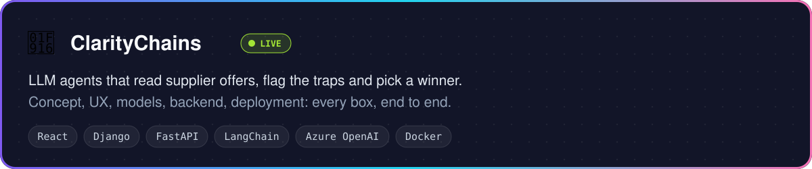
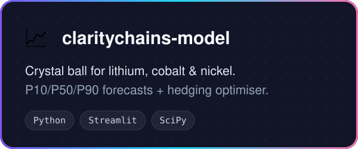
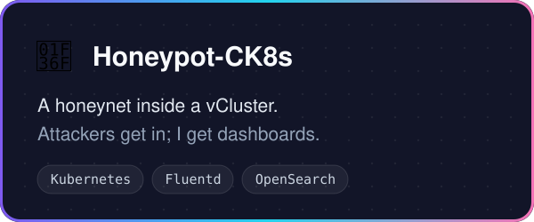
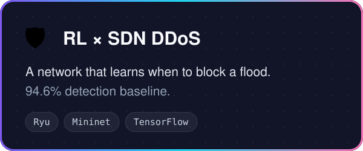
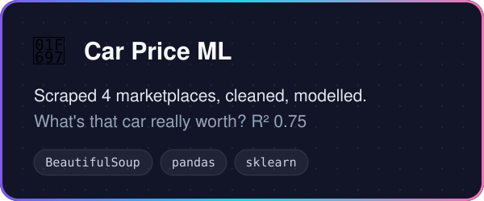

  
  
  

<i>I don't stay in one lane. I take an idea from a napkin sketch to a running cluster, and I like owning every step in between.</i>

## 📖 The story so far

**01 · It started with packets 📡** 
I trained as a network and telecom engineer, so my first obsession was how data travels. I taught an SDN controller to [spot DDoS floods and fight back with reinforcement learning](https://github.com/OnsKoukiPro/RL-based-DDos-Mitigation-in-SDN-based-broadband-networks), and later helped plan fibre and 5G networks at Omantel.

**02 · Then I wanted to meet the attackers 🍯** 
So I built them a trap: a [Kubernetes honeynet](https://github.com/OnsKoukiPro/Honeypot-CK8s) that streams every move into live dashboards. At Speedykom I secured and automated an [open-source pandemic analytics platform](https://github.com/OnsKoukiPro/Regional-Pandemic-Analytics) with Kubernetes, Vault, Keycloak and GitHub Actions.

**03 · Then the data started talking 🎧** 
At Bridges For Fairness I trained CNNs and RNNs on acoustic-emission signals to predict failure before it happens. For fun, I [scraped four car marketplaces](https://github.com/OnsKoukiPro/ML-Car-Price-Prediction) to find out what a used car is really worth.

**04 · Then I built a startup's brain from zero 🧠** 
As founding AI/ML engineer at Clarity Chain I took one idea all the way: battery-metal price forecasts, hedging, and an LLM agent that reads supplier offers and tells you who to pick.

**05 · Now: powering the energy transition 🔋** 
Master's thesis at ACCURE Battery Intelligence, building platform services for battery-storage customers on AWS EKS with Helm, Argo CD and Pulumi.

## 🚀 Things I've made

<a href="https://clarity-chains.vercel.app"><b>▶ try the live demo</b></a>

  
  
  
  

## 🧰 My toolbox

   
  

🗣️ English · French · Arabic

